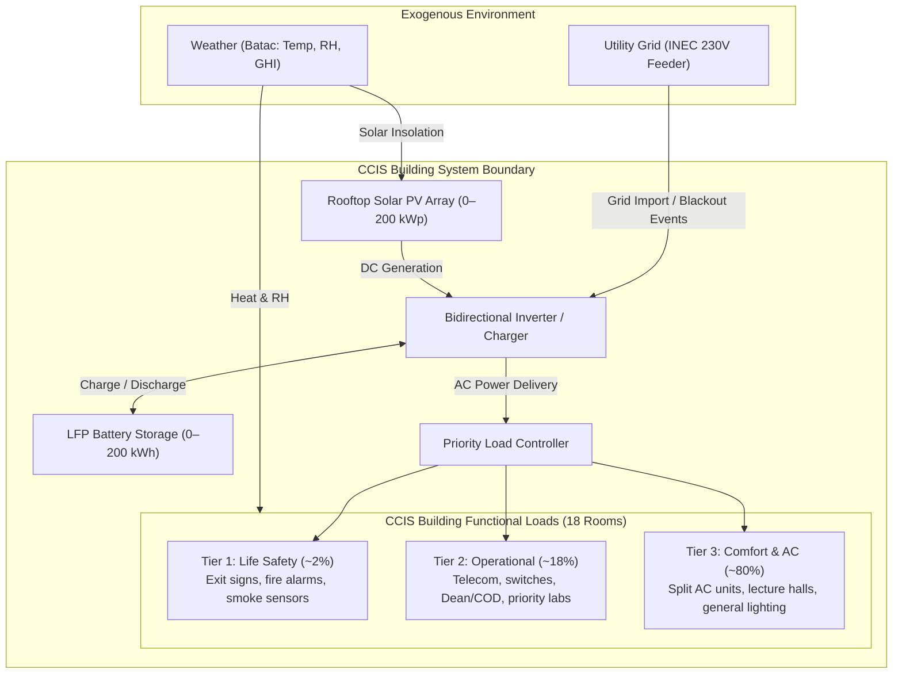
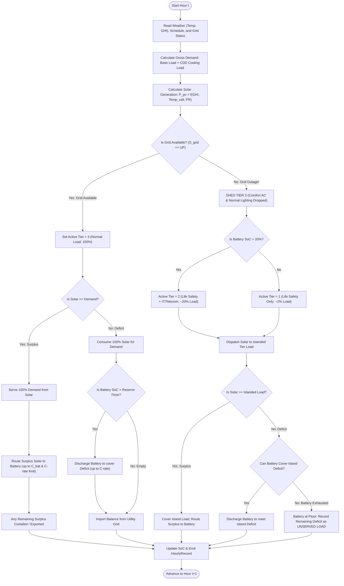

# Conceptual Model & Interface Specification — CCIS Heat, Load and Backup Power Simulation

This document specifies the conceptual foundation, mathematical entities, state dynamics, performance measures, decision variables, and interface contracts for the CCIS Heat, Load and Backup Power Simulation. It fulfills the formal requirements for **Project Outline Sections 1, 2, and 3** for the Modelling and Simulation course.

---

## 1. System Boundary & Physical Entities (Outline §1 & §2.1)

### 1.1 Problem Context & Primary Objective
In Batac, Ilocos Norte, elevated ambient summer temperatures drive intense building cooling demand. Compounding this thermal stress, the local power grid is vulnerable to utility supply interruptions, particularly during western Pacific tropical cyclone seasons. 

The primary objective of this simulation is to answer:
> **How much does Batac's heat raise the electricity consumption of the MMSU College of Computing and Information Sciences (CCIS), and what sizing of rooftop solar PV and battery energy storage (BESS) can reliably cover building demand during extreme heat waves and grid blackouts?**

### 1.2 System Boundary
The system boundary encompasses the physical facilities, internal electrical loads, on-site distributed energy resources (DER), and utility interface of the **Mariano Marcos State University (MMSU) College of Computing and Information Sciences (CCIS)** in Batac, Ilocos Norte (`18.06° N, 120.56° E`).

- **Inside the Boundary:**
  - CCIS 2-storey facility (~2,500 m² gross floor area) and its internal equipment loads across 18 designated functional rooms.
  - Rooftop solar photovoltaic (PV) array mounted on the CCIS roof.
  - Lithium Iron Phosphate (LFP) Battery Energy Storage System (BESS) and bidirectional battery inverter.
  - Building Priority Load Controller (automated load-shedding contactors).
  - Internal electrical distribution panelboard and Point of Common Coupling (PCC).
- **Outside the Boundary (Exogenous Environment):**
  - Ambient meteorological conditions: dry-bulb temperature ($T_{\text{amb}}$), relative humidity ($RH$), and solar irradiance ($GHI$).
  - Ilocos Norte Electric Cooperative (INEC) distribution grid reliability / outage events.
  - Institutional campus administration and municipal water/utility infrastructure.



### 1.3 Physical Entities & Building Layout ([D-06])
The facility is parameterized as an academic building with **18 dedicated spaces** based on verified MMSU CCIS ground truth:
1. **Hyflex Smart Classrooms (2 rooms):** High-density active learning spaces with interactive smart displays, studio cameras, instructor workstations, LED lighting, and 2.0 HP inverter split AC units.
2. **Standard Lecture Rooms (6 rooms):** 40-seat lecture halls equipped with ceiling fans, data projectors, ceiling LED lighting, and 2.0 HP split AC units.
3. **Computer Laboratories (6 rooms):** 35–40 desktop PCs + monitors per lab, network edge switches, instructor terminals, and dual 2.0–2.5 HP split AC units.
4. **College Office / Department Chair (COD) Room (1 room):** Department head office, administrative computing, laser printer, LED lighting, and 1.5 HP inverter split AC.
5. **Dean's Office + Secretary Ante-Room (1 room):** Executive college office, desktop PCs, executive lighting, document scanner, and 1.5 HP inverter split AC.
6. **Faculty Rooms (2 rooms):** Shared academic workspaces with 15–20 faculty desks, laptops/PCs, water dispenser, perimeter lighting, and dual 2.0 HP split AC units.
7. **Infrastructure / Common Hallways:** Distributed IDF networking cabinets, emergency egress illumination, domestic water booster pump, and stairwells. *(Note: Per [D-06], there is NO dedicated central server room; core switches and departmental routers are distributed in secured office/IDF closets).*

---

## 2. State Variables, Events & Temporal Dynamics (Outline §3.1)

### 2.1 Temporal Framework ([D-05])
- **Resolution:** Discrete hourly time steps ($\Delta t = 1.0\text{ hour}$).
- **Horizon:** Full annual cycle ($t = 1, 2, \dots, 8760\text{ hours}$), indexing from January 1, 00:00 to December 31, 23:00 Philippine Standard Time ($\text{PST} = \text{UTC}+8$).

### 2.2 System State Variables
At every simulation hour $t$, the state of the CCIS microgrid is completely described by the vector:
$$S(t) = \left\langle t,\, T_{\text{amb}}(t),\, RH(t),\, GHI(t),\, P_{\text{load}}(t),\, P_{\text{pv}}(t),\, SoC(t),\, S_{\text{grid}}(t),\, S_{\text{tier}}(t) \right\rangle$$

| Variable | Symbol | Domain / Units | Nature | Description |
| :--- | :---: | :---: | :---: | :--- |
| **Simulation Hour** | $t$ | $1, \dots, 8760$ (hours) | Discrete | Chronological hour of the year. |
| **Ambient Temperature** | $T_{\text{amb}}(t)$ | $[-10, 50]^\circ\text{C}$ | Continuous | Outdoor dry-bulb air temperature from NASA POWER. |
| **Relative Humidity** | $RH(t)$ | $[0, 100]\%$ | Continuous | Outdoor relative humidity. |
| **Global Irradiance** | $GHI(t)$ | $[0, 1400]\text{ W/m}^2$ | Continuous | Surface all-sky solar insolation. |
| **Unconstrained Demand** | $P_{\text{gross}}(t)$ | $[0, 100]\text{ kW}$ | Continuous | Total electrical demand requested by CCIS equipment. |
| **Actual Demand Served** | $P_{\text{served}}(t)$ | $[0, 100]\text{ kW}$ | Continuous | Load actively energized after load-shedding control. |
| **Solar Generation** | $P_{\text{pv}}(t)$ | $[0, P_{\text{kWp}}]\text{ kW}$ | Continuous | Net AC electrical output of the solar array. |
| **Battery Energy State** | $SoC(t)$ | $[SoC_{\min}, C_{\text{bat}}]\text{ kWh}$ | Continuous | Stored energy in the battery at the conclusion of hour $t$. |
| **Grid Availability** | $S_{\text{grid}}(t)$ | $\{\text{UP}, \text{DOWN}\}$ | Discrete | Utility status ($1 = \text{Energized}$, $0 = \text{Blackout}$). |
| **Active Load Tier** | $S_{\text{tier}}(t)$ | $\{\text{Tier 1}, \text{Tier 2}, \text{Tier 3}\}$ | Discrete | Lowest priority tier permitted to draw power. |

### 2.3 Discrete Events
State changes occur via time-stepped progression and the firing of discrete asynchronous events:
1. **Outage Initiation Event ($E_{\text{outage\_start}}$):** Grid transitions from $\text{UP} \to \text{DOWN}$. Inverter islanding opens grid breaker; Priority Load Controller automatically sheds Tier 3 (comfort AC and general lighting) within $<1\text{ second}$.
2. **Outage Restoration Event ($E_{\text{outage\_end}}$):** Grid transitions from $\text{DOWN} \to \text{UP}$. Grid synchronization occurs; all tiers restore normal service.
3. **Occupancy Schedule Transition ($E_{\text{schedule}}$):** Step change in base lighting and IT plug loads matching academic timetable (08:00 start, 17:00 end, weekend setbacks, exam periods).
4. **Battery Emergency Floor Event ($E_{\text{soc\_floor}}$):** Battery reaches non-discretionary reserve floor ($SoC(t) = SoC_{\min} = 0.10 \times C_{\text{bat}}$). Discharge terminates instantly to protect cells from permanent under-voltage degradation.
5. **Battery Low-Reserve Warning ($E_{\text{soc\_low}}$):** During an outage, if $SoC(t)$ drops below 20% of capacity, Tier 2 loads are shed to preserve Tier 1 life-safety circuits.

---

## 3. Performance Measures & Decision Variables (Outline §2.2)

### 3.1 Performance Measures (Output Metrics)
The simulation evaluates candidate configurations across 6 primary metrics:

1. **Solar Self-Sufficiency Ratio ($\text{SSR}$):**
   $$\text{SSR} = \frac{\sum_{t=1}^{8760} P_{\text{pv\_to\_load}}(t) + P_{\text{bat\_to\_load}}(t)}{\sum_{t=1}^{8760} P_{\text{gross}}(t)} \times 100\%$$
   The fraction of annual CCIS electrical consumption supplied directly or indirectly by on-site solar.
2. **Solar Self-Consumption Ratio ($\text{SCR}$):**
   $$\text{SCR} = \frac{\sum_{t=1}^{8760} P_{\text{pv\_to\_load}}(t) + P_{\text{pv\_to\_bat}}(t)}{\sum_{t=1}^{8760} P_{\text{pv}}(t)} \times 100\%$$
   The fraction of total generated solar energy utilized on-site rather than curtailed or exported.
3. **Outage Autonomy (Hours Fully Covered):**
   $$H_{\text{full}} = \sum_{t \in \text{Outage}} \mathbb{I}\left(P_{\text{unserved}}(t) = 0\right)$$
   Total blackout hours where 100% of the active operational load was satisfied by solar + battery.
4. **Critical-Load Coverage Fraction:**
   $$F_{\text{crit}} = \frac{\sum_{t \in \text{Outage}} P_{\text{served, Tier 1+2}}(t)}{\sum_{t \in \text{Outage}} P_{\text{demand, Tier 1+2}}(t)} \times 100\%$$
   Reliability metric assessing life-safety and operational continuity during utility blackouts.
5. **Expected Unserved Energy ($\text{EUE}$):**
   $$\text{EUE} = \sum_{t=1}^{8760} P_{\text{unserved}}(t) \quad (\text{kWh/year})$$
   Total unserved energy demand across the simulation year.
6. **Minimum State of Charge ($\min SoC$):**
   $$SoC_{\text{worst}} = \min_{t=1}^{8760} SoC(t) \quad (\text{kWh})$$
   Stress metric recording deepest battery drawdown during storm and outage episodes.

### 3.2 Decision Variables
The system sizing and dispatch optimization sweeps the following decision space:
- **Solar PV Installed Capacity ($P_{\text{kWp}}$):** Continuous parameter evaluated at discrete candidate levels:
  $$P_{\text{kWp}} \in \{0,\, 50,\, 100,\, 200\}\text{ kWp}$$
  *(Upper bound 200 kWp constrained by ~1,200 m² usable CCIS rooftop area at 6.0 m²/kWp).*
- **Battery Storage Energy Capacity ($C_{\text{bat}}$):**
  $$C_{\text{bat}} \in \{0,\, 50,\, 100,\, 200\}\text{ kWh}$$
- **Outage Emergency Reserve Allocation ($R_{\text{reserve}}$):**
  $$R_{\text{reserve}} \in [0.10,\, 0.50] \quad (\text{Default: } 0.20 \text{ or 20\% reserved for blackouts})$$
- **Load Shedding Trigger Threshold ($SoC_{\text{shed2}}$):**
  $$SoC_{\text{shed2}} = 0.20 \times C_{\text{bat}} \quad (\text{Trigger for shedding Tier 2 operational loads})$$

---

## 4. Canonical Interface Contract (`HourlyRecord` & Invariants)

All sub-modules (Demand, Solar, Battery, Outage, Integration) must conform to the following immutable dataclass specification for time-step records:

```python
from dataclasses import dataclass

@dataclass(frozen=True)
class HourlyRecord:
    """Canonical time-step record representing the complete state of the CCIS microgrid."""
    hour: int                     # 1 to 8760 (chronological hour of year)
    timestamp: str                # ISO 8601 string (e.g., "2026-04-15T14:00:00+08:00")
    temp_ambient_c: float         # Ambient dry-bulb temperature (°C)
    humidity_rel_pct: float       # Relative humidity (%)
    ghi_w_m2: float               # Global Horizontal Solar Irradiance (W/m²)
    demand_gross_kwh: float       # Total unconstrained building electrical load (kWh)
    demand_served_kwh: float      # Actual electrical load served after load shedding (kWh)
    solar_generation_kwh: float   # Net AC electrical generation from PV array (kWh)
    solar_to_demand_kwh: float    # Direct solar electricity consumed by building (kWh)
    solar_to_battery_kwh: float   # Excess solar electricity routed to battery charging (kWh)
    solar_curtailed_kwh: float    # Excess generation curtailed or exported to grid (kWh)
    battery_soc_kwh: float        # Battery usable energy stored at end of hour (kWh)
    battery_charge_kwh: float     # Energy transferred into battery during this hour (kWh)
    battery_discharge_kwh: float  # Energy extracted from battery during this hour (kWh)
    grid_import_kwh: float        # Electrical energy imported from INEC utility grid (kWh)
    unserved_load_kwh: float      # Deficit electrical energy unserved during blackout (kWh)
    grid_available: bool          # True = INEC grid UP; False = Outage / Blackout
    active_load_tier: int         # 1 = Life Safety only, 2 = Essential IT, 3 = Normal (all loads)
```

### Strict Physical Conservation Invariant
At every time-step $t$, energy conservation must hold exactly within numerical floating-point precision:
$$\left| \left( P_{\text{pv}}(t) + P_{\text{grid\_in}}(t) + P_{\text{bat\_dis}}(t) \right) - \left( P_{\text{served}}(t) + P_{\text{bat\_chg}}(t) + P_{\text{curtail}}(t) \right) \right| \le 10^{-5}\text{ kWh}$$

### Battery Boundary Invariants
$$\forall t: \quad 0.10 \times C_{\text{bat}} \le SoC(t) \le C_{\text{bat}}$$
$$P_{\text{bat\_chg}}(t) \times P_{\text{bat\_dis}}(t) = 0 \quad (\text{No simultaneous charging and discharging})$$

---

## 5. System Logic & Dispatch Flowcharts (Outline §3.2)

The dispatch controller executes sequentially at every hour $t$:



---

## 6. Sourced vs. Assumed Parameter Traceability Matrix

| Parameter | Value | Status | Formal Citation / Reference | Decision Tag |
| :--- | :---: | :---: | :--- | :---: |
| **Site Coordinates** | 18.06°N, 120.56°E | Sourced | Geographic centroid for Batac, Ilocos Norte | — |
| **CCIS Room Count** | 18 rooms | Sourced | MMSU CCIS campus ground truth | `[D-06]` |
| **Time-Step** | 1.0 hour | Sourced | Building simulation literature | `[D-05]` |
| **Cooling Base Temp** | 24.0°C | Sourced | ASHRAE Standard 55 / Tropical comfort standard | `[D-07]` |
| **Cooling Sensitivity** | 4.0% / °C | Sourced | Tropical office regression studies (3–5%/°C range) | `[D-07]` |
| **Latent Humidity Penalty**| +20% | Sourced | Maritime psychrometric modeling (10–30% range) | `[D-07]` |
| **Solar Tilt / Azimuth** | 15° True South | Sourced | Regional solar geometry benchmark | `[D-08]` |
| **Solar PR Benchmark** | 0.77 (77%) | Sourced | 103-system Luzon field study (Solaren / DOE 2025) | `[D-08]` |
| **Specific Yield Target** | 1,298 kWh/kWp·yr | Sourced | Luzon monitored PV study empirical mean | `[D-08]` |
| **PV Temperature Coeff** | -0.40% / °C | Sourced | Mono-PERC crystalline silicon standard datasheet | `[D-08]` |
| **Battery Chemistry** | LFP ($\text{LiFePO}_4$) | Sourced | Standard for tropical stationary energy storage | `[D-09]` |
| **Battery Round-Trip Eff**| 92.0% | Sourced | Commercial LFP BESS specifications | `[D-09]` |
| **Battery Usable DoD** | 90.0% (10% min SoC) | Sourced | Cell protection manufacturer guidelines | `[D-09]` |
| **Load Tiering Fractions** | Tier 1: 2%, Tier 2: 18%, Tier 3: 80% | Sourced / Assumed | Philippine Electrical Code (PEC) & NFPA 110 | `[D-10]` |
| **Normal Outage Arrival** | $\lambda = 3.0\text{/yr}$ | Assumed / Sourced | Rural electric cooperative reliability benchmarking | `[D-11]` |
| **Normal Outage Duration**| $\mu=1.2, \sigma=0.8$ (Lognormal) | Assumed / Sourced | Grid distribution restoration literature | `[D-11]` |
| **Typhoon Outage Arrival** | $\lambda = 8.0\text{/yr}$ | Assumed / Sourced | Super Typhoon Nando DOE Region I damage reports | `[D-11]` |
| **Typhoon Outage Duration**| $\mu=2.3, \sigma=1.0$ (Lognormal) | Assumed / Sourced | DOE post-disaster re-energization timeline | `[D-11]` |
| **Storm Solar Depression** | 20–30% normal GHI (3–5 days) | Sourced | Satellite cloud cover analysis during tropical cyclones | `[D-11]` |
