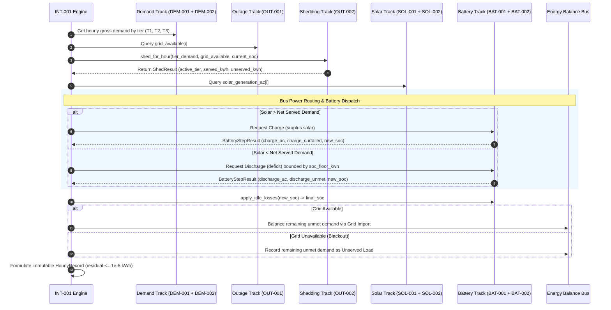

# Phase 2 Interface Contracts & Integration Architecture Specification

**Document Version:** 1.0.0  
**Status:** Locked per Decision [D-26] (CORE-006)  
**Applies to:** Phase 2 Sub-Model Tracks (`DEM-001`, `DEM-002`, `SOL-001`, `SOL-002`, `BAT-001`, `BAT-002`, `OUT-001`, `OUT-002`) and Phase 3 Integration (`INT-001`).

---

## 1. Executive Summary & Purpose

Phase 2 decomposes the CCIS microgrid simulation into eight parallel tracks implemented concurrently by local agents. To guarantee seamless integration under `INT-001` and eliminate API divergence, this contract locks:
1. **Canonical Shared Data Structures** (`ccis_sim.core.interfaces`): Immutable numpy array containers for tiered demand, academic calendars, outage schedules, battery dispatch results, and load shedding outcomes.
2. **Sub-Model Function Signatures**: Exact function names, arguments, keyword-only parameters, and return types across all eight track modules.
3. **Execution Conventions & Design Rules**: Pure functions, explicit RNG passing, immutable inputs, and weather dataframe column standards.
4. **The INT-001 Hourly Dispatch Sequence**: How all eight sub-models compose inside the annual time loop to produce valid `HourlyRecord` streams.

---

## 2. Core Operational Conventions

All Phase 2 sub-models must strictly adhere to the following principles:
- **Pure Functions:** Sub-model logic must have no side effects, no global state, and no file I/O inside domain calculation routines (data loading is isolated to loaders and test harnesses).
- **Explicit Deterministic PRNG:** Stochastic routines (`OUT-001`) must never invoke `random.*` or `np.random.*` globally; they must accept an explicit `rng: numpy.random.Generator` instance.
- **Input Immutability:** Functions must treat input dataframes, arrays, and dataclasses as strictly read-only.
- **Weather DataFrame Contract:** Weather inputs must use verified column names provided by `load_weather_fixture`:
  - `hour`: Integer chronological hour index ($1 \dots 8760$).
  - `timestamp`: ISO 8601 string (`YYYY-MM-DDTHH:MM:SS+08:00`).
  - `t_amb`: Ambient dry-bulb temperature in degrees Celsius (°C).
  - `rh`: Relative humidity percentage ($0.0 \dots 100.0\%$).
  - `ghi`: Global Horizontal Irradiance in watts per square meter ($\text{W/m}^2$).
- **Array Conventions:** Hourly time-series arrays are 1D `numpy.ndarray` instances of length $N = 8,760$ (index $i$ represents hour $i + 1$). Flow rates are in kilowatt-hours per hour ($\text{kWh/h} \equiv \text{kW}$ at $\Delta t = 1.0\text{ h}$).

---

## 3. Sub-Model Function Signatures & Module Manifest

| Track | Target Module | Function / Class Signature | Summary & Units |
| :--- | :--- | :--- | :--- |
| **DEM-001** | `ccis_sim.demand.schedule` | `build_occupancy_schedule(timestamps: pd.Series, *, calendar: AcademicCalendar \| None = None) -> OccupancySchedule` | Generates 8,760h academic occupancy fractions and class/break/holiday calendar flags. |
| **DEM-001** | `ccis_sim.demand.non_cooling` | `compute_non_cooling_demand(schedule: OccupancySchedule, audit: EquipmentAudit, building: Building) -> TieredDemand` | Computes bottom-up lighting, IT, and plug electrical loads across Tiers 1–3. |
| **DEM-002** | `ccis_sim.demand.cooling` | `compute_cooling_demand(weather_df: pd.DataFrame, occupancy_fraction: np.ndarray, audit: EquipmentAudit, building: Building) -> TieredDemand` | Computes temperature- and humidity-sensitive AC cooling demand across Tiers 1–3. |
| **SOL-001** | `ccis_sim.solar.irradiance` | `compute_dc_power_per_kwp(weather_df: pd.DataFrame, *, tilt_deg: float = 15.0, azimuth_deg: float = 180.0, latitude_deg: float = 18.06, longitude_deg: float = 120.56) -> np.ndarray` | Computes hourly DC yield per kWp before inverter and balance-of-system losses (kW/kWp). |
| **SOL-002** | `ccis_sim.solar.array` | `compute_ac_generation(dc_kw_per_kwp: np.ndarray, array: SolarArray) -> np.ndarray` | Scales array capacity, models inverter clipping/efficiency, and applies non-temperature BOS derates to yield AC generation (kWh/h). |
| **BAT-001** | `ccis_sim.battery.dynamics` | `step_battery(soc_kwh: float, battery: Battery, charge_request_kwh: float, discharge_request_kwh: float, *, soc_floor_kwh: float \| None = None, delta_t_hours: float = 1.0) -> BatteryStepResult` | Dispatches battery for a single hour under C-rate and symmetric conversion efficiency constraints. |
| **BAT-002** | `ccis_sim.battery.reserve` | `soc_floor_kwh(battery: Battery, *, grid_available: bool, active_load_tier: LoadTier, allow_emergency_drawdown: bool = False) -> float` | Computes dynamic operational/hardware protection floor based on grid and tier state. |
| **BAT-002** | `ccis_sim.battery.reserve` | `apply_idle_losses(soc_kwh: float, battery: Battery, delta_t_hours: float = 1.0) -> tuple[float, float]` | Applies electrochemical self-discharge and BMS standby tare losses: returns `(new_soc_kwh, loss_kwh)`. |
| **OUT-001** | `ccis_sim.outage.sampler` | `sample_outage_schedule(year_type: str, rng: np.random.Generator, *, n_hours: int = 8760) -> OutageSchedule` | Generates stochastic Poisson outage arrivals, lognormal durations, and typhoon storm windows. |
| **OUT-001** | `ccis_sim.outage.sampler` | `apply_ghi_multiplier(weather_df: pd.DataFrame, schedule: OutageSchedule) -> pd.DataFrame` | Attenuates solar GHI during active typhoon depression windows ($0.20 \dots 0.30 \times \text{GHI}$). |
| **OUT-002** | `ccis_sim.outage.shedding` | `shed_for_hour(tier_demand_kwh: tuple[float, float, float], *, grid_available: bool, soc_kwh: float, battery: Battery, tier2_shed_soc_fraction: float = 0.20) -> ShedResult` | Evaluates priority-based load shedding based on grid availability and battery State-of-Charge. |
| **OUT-002** | `ccis_sim.outage.shedding` | Class `UnservedTracker` | State tracker accumulating per-tier unserved electrical energy (kWh) and outage duration metrics. |

---

## 4. Cross-Track Coupling & Boundary Rules

1. **Demand Separation (`DEM-001` & `DEM-002`):**
   - Non-cooling demand (`DEM-001`) and cooling response (`DEM-002`) are computed as independent `TieredDemand` instances.
   - `INT-001` sums them linearly per tier ($P_{\text{tier}, i} = P_{\text{non\_cooling}, \text{tier}, i} + P_{\text{cooling}, \text{tier}, i}$).
   - `compute_cooling_demand` consumes `occupancy_fraction` as a raw 1D `numpy.ndarray`, decoupling `DEM-002` from any class definitions in `DEM-001`.
2. **Thermal Derating and PR De-duplication (`SOL-001` & `SOL-002`):**
   - `SOL-001` explicitly computes the cell temperature and temperature derating ($\gamma = -0.40\%/^\circ\text{C}$, NOCT = $45^\circ\text{C}$, roof penalty $= +10^\circ\text{C}$).
   - `SOL-002` applies array capacity scaling, inverter clipping, and balance-of-system (BOS) derating ($PR = 0.77$ per `[D-08]`).
   - `SOL-002` must **never** double-count temperature losses: it must decompose the baseline $PR = 0.77$ into nominal thermal efficiency and non-thermal components (soiling, wiring, inverter, mismatch), applying only the non-thermal factors to the temperature-derated DC yield.
3. **Low-SoC Shedding vs. Emergency Reserve (`OUT-002` & `BAT-002`):**
   - The 20% low-SoC Tier 2 shedding threshold (`OUT-002.3`, defaulting to $0.20 \times C_{\text{bat}}$) is functionally distinct from `Battery.emergency_reserve_pct` (`[D-17]`).
   - `OUT-002` accepts `tier2_shed_soc_fraction: float = 0.20` as an explicit parameter so `INT-001` can study independent sensitivity sweeps.
4. **Battery Idle Loss Accounting (`BAT-002` & `[D-26]`):**
   - Idle losses (ambient self-discharge of 2%/month and tare standby loss) are modeled **strictly on the stored chemical SoC-side**.
   - Standby losses dissipate chemical energy inside the cell, reducing State-of-Charge without introducing phantom AC-side building electrical loads or perturbing bus power conservation.

---

## 5. Intended INT-001 Simulation Loop Workflow

For each chronological hour $i \in [0, 8759]$ ($t = i + 1$), the simulation engine executes the following sequential dispatch logic:

1. **Demand Aggregation:** Sum cooling and non-cooling demand per tier to form `tier_demand_kwh = (T1, T2, T3)`.
2. **Grid Status Evaluation:** Read `grid_available[i]` from `OutageSchedule`.
3. **Priority Shedding:** Pass `tier_demand_kwh`, `grid_available`, and current battery State-of-Charge to `shed_for_hour` to determine `active_load_tier` and target served vs. unserved demand.
4. **Solar Generation Availability:** Retrieve $P_{\text{solar}, i}$ from `SOL-002`.
5. **Microgrid Bus Dispatch:**
   - If solar generation exceeds served demand: direct solar serves load; surplus is offered to battery charging (`charge_request_kwh`). Any remaining surplus that exceeds battery C-rate or capacity limits is recorded as `solar_curtailed_kwh`.
   - If served demand exceeds solar generation: all solar is dedicated to demand; remaining demand deficit is requested from battery discharge (`discharge_request_kwh`), bounded by `soc_floor_kwh`.
6. **Battery Step & Idle Losses:** Invoke `step_battery` to compute AC-side flows and new chemical SoC. Apply `apply_idle_losses` to account for hourly tare and self-discharge.
7. **Grid Balance & Outage Recording:**
   - If grid is available (`grid_available == True`): any deficit after battery discharge is covered by `grid_import_kwh`.
   - If grid is unavailable (`grid_available == False`): any remaining deficit becomes `unserved_load_kwh`.
8. **Record Serialization & Invariant Verification:** Construct the canonical `HourlyRecord`. All flows satisfy exact first-law balance ($E_{\text{in}} - E_{\text{out}} \le 10^{-5}\text{ kWh}$) and physical battery boundaries.
