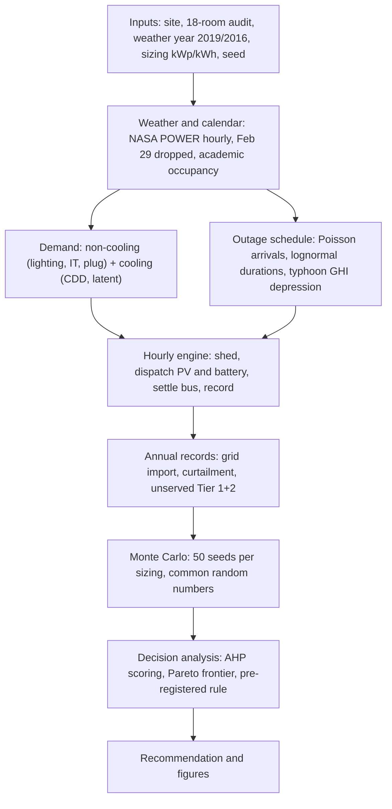
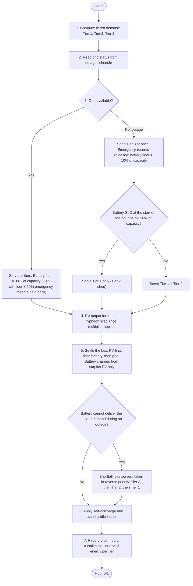
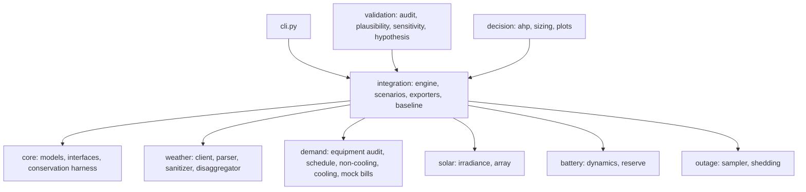
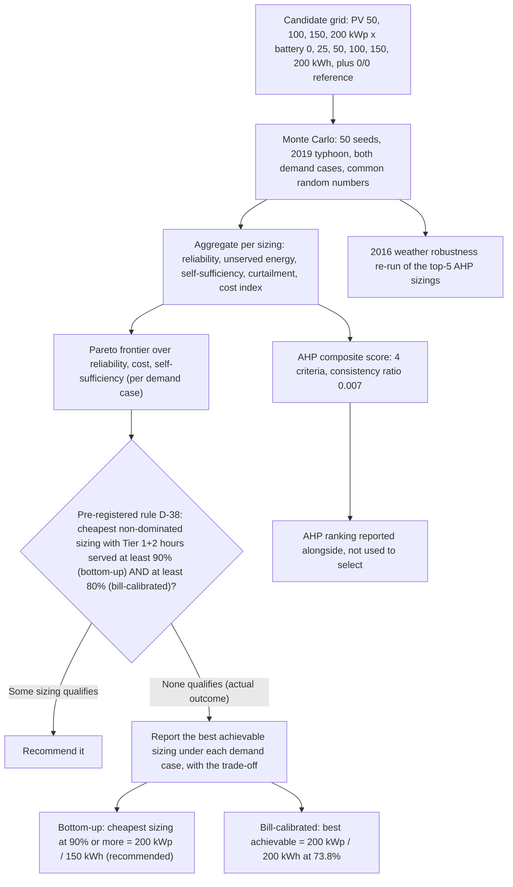

# Illustrations — CCIS Engineering Report

This file holds the diagram sources for the hand-assembled Google Docs version of
`CCIS-engineering-report.md`. Google Docs does not render Mermaid, so each diagram is kept
here as source and is pasted into Google Docs through a Mermaid renderer or converted to an
image first. Section references (§3, §5) point back to the report.

Sources: `docs/context/conceptual-model.md` and `docs/context/phase2-interface-contract.md`
for the system and hourly logic; the implementation (`src/ccis_sim/`) for anything the two
documents describe loosely; `docs/decisions/decision-log.md` for the decision pipeline.

**Revision note (2026-10-26).** D1–D4 were parsed and rendered with `mmdc` at review, which
also checked the syntax that could not be checked when the file was first written. D1 and D3
are unchanged. D2 and D4 were corrected: D4 now shows the [D-38] fallback branch, because no
sizing reaches 80% under bill-calibrated demand; D2 gains the battery floors of [D-32] and the
reverse-priority shortfall allocation of [D-34]. D2's SoC test is at the start of the hour, as
the engine's own docstring states (`src/ccis_sim/outage/shedding.py`, `shed_for_hour`).

---

## D1 — Overall simulation flow

**Suggested caption:** Figure D1. End-to-end simulation flow, from exogenous inputs to the
Monte Carlo sizing study and the decision analysis.
**Target section:** §3 Conceptual model.

---

## D2 — Hourly event order and shedding rules

**Suggested caption:** Figure D2. Order of operations inside one simulated hour, including the
load-shedding rules and the settle order.
**Target section:** §3.2 and §3.3.

---

## D3 — Software architecture

**Suggested caption:** Figure D3. Package layout of `ccis_sim` and the direction of data flow.
**Target section:** §5.2.

---

## D4 — Decision pipeline

**Suggested caption:** Figure D4. From candidate grid to recommendation: Monte Carlo study,
AHP scoring, Pareto frontier, and the pre-registered selection rule.
**Target section:** §7.2.

---

## Decorative image prompts

These are **decorative only** (cover or context illustrations). No technical diagram is to be
produced from an image prompt: labels and flows in D1–D4 must stay exact and are delivered as
Mermaid source above.

### I1 — Cover illustration

> A single-storey-fronted two-storey university college building in a hot, humid Philippine
> provincial setting, seen from the front at midday; a flat roof covered with dark-blue solar
> panels; a small battery cabinet on the ground beside the entrance; palm trees and a
> tropical sky with cumulus clouds; warm natural light; wide landscape composition with empty
> sky space at the top. Style: clean editorial illustration, muted realistic palette. No text,
> no numbers, no logos, no institutional branding, no identifiable real building.

### I2 — Context illustration

> Cutaway-style illustration of a campus building at night during a storm: rain on the
> windows, the surrounding street lights dark, but warm light glowing from a few interior
> rooms and corridor exit signs; solar panels on the roof; a compact battery cabinet inside a
> utility closet. Style: clean editorial illustration, muted realistic palette. No text, no
> numbers, no logos, no institutional branding.
