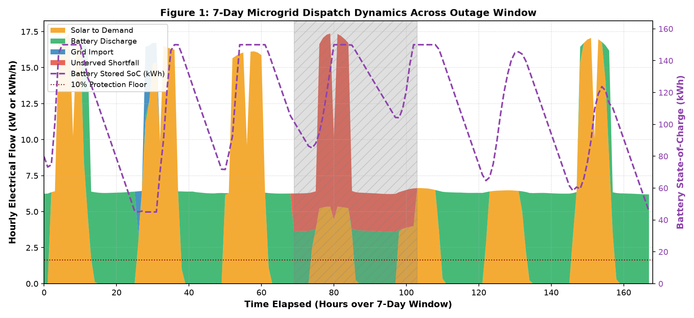
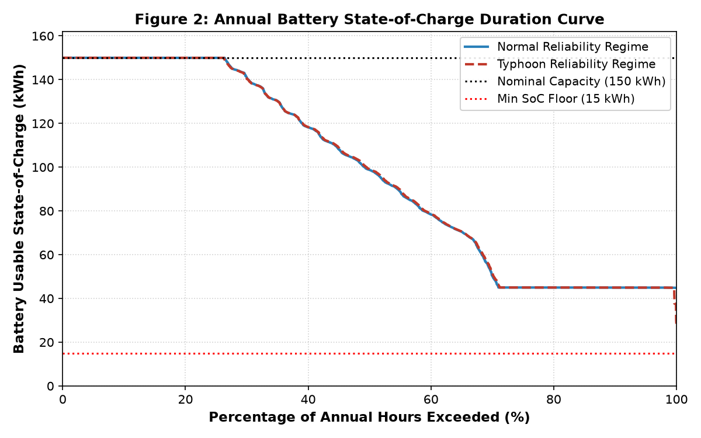
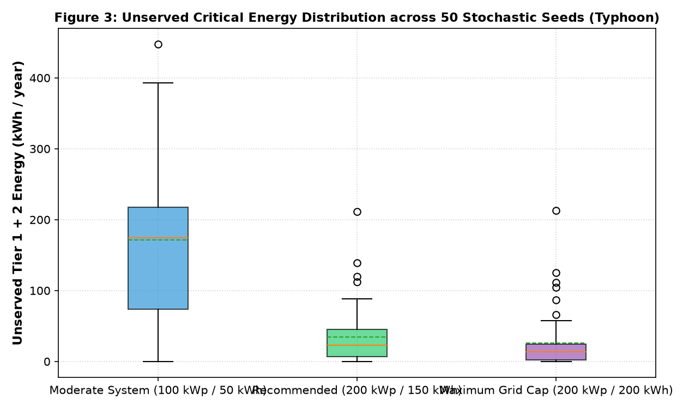
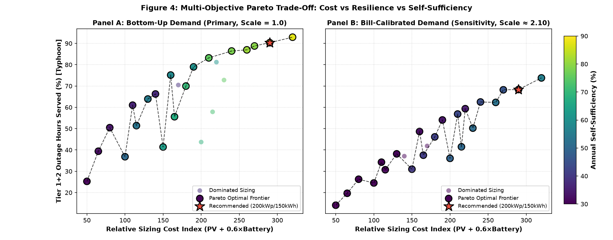
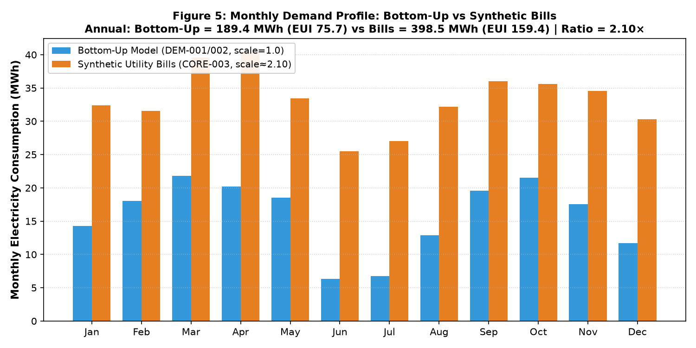

# Task Report: DOC-003 — Complete the engineering report against the course Project Outline

**Date:** 2026-10-26  
**Agent:** claude-code  
**Task ID:** DOC-003  
**Status:** done  
**Commit:** `d55c286` — `docs(DOC-003): complete engineering report against course outline`  
**Patch File:** `patch/DOC-003-claude-code-report-completion.patch`  
**Branch / Worktree:** `task/DOC-003` at `../ccis-heat-load-backup-sim-DOC-003`, based on `f12eb29` (`task/DEC-003.3` tip)

---

## 1. Executive Summary

DOC-003 closes the gap between `docs/paper/CCIS-engineering-report.md` and the course Project Outline. The report already followed the outline's section numbering; this task filled the sections that were missing or asserted, and removed the stale statements that a reader would trip over: the "281 tests on master" line and the Appendix D item that still described the `×100.2` typo as open.

The work adds a title block with placeholders for the data only the team knows, a diagram section backed by a separate Mermaid source file, the two statistical-methods subsections the outline requires (data cleaning, and what was not fitted), an explicit subject-matter-expert review status with a blank review record, five embedded figures whose captions were checked against the images, one real CLI output capture, and two generated program listings (full and core). No finding, number or conclusion in §8 was changed.

Tests: **290 passed** at task start and **290 passed** at task end, both pasted unannotated in §3.1. The report passes the committed `validate-report.py`, and the generator is byte-deterministic across two runs.

---

## 2. Implementation Details

### 2.1 Changes made

- `docs/paper/CCIS-engineering-report.md` (356 → 491 lines): title block; metadata and reader's-note update; new §3.4 Diagrams; new §4.3 Data cleaning and §4.4 What was not fitted; new §6.6 SME review status; §7.5 rewritten with embedded figures 1–5, corrected captions and a real Figure 6 capture; §10 and Appendix C rewritten around the two listings; Appendix A gains D-41; Appendix D item 9 reworded as corrected; new Appendix E blank review record; two test-count statements corrected.
- `scripts/build_program_listing.py` (new, 208 lines): deterministic listing generator. Sorted paths, no timestamps, no commit hashes. Reads purposes and indexed line counts from `results/program_listing_index.md`; falls back to the module docstring for files the index does not cover (only `scripts/run_decision_pipeline.py`).
- `docs/paper/program-listing.md` (new, 10,063 lines, 398,027 bytes): full listing, all 42 `src/ccis_sim` files plus `scripts/run_decision_pipeline.py`, with a contents table and the test suite listed by index only.
- `docs/paper/program-listing-core.md` (new, 4,768 lines, 202,415 bytes): 15 core files reproduced, 28 remaining source files and 22 test files listed by index only.
- `docs/paper/illustrations.md` (new, 126 lines): Mermaid sources D1–D4 with suggested captions and target sections, plus two decorative image-generation prompts.
- `docs/decisions/decision-log.md`: appended [D-41] (deliverable packaging, figure references, Markdown-only, 2026-11-03).
- `docs/tasks/status.md`: added the DOC-003 row as `done`, linking this report.

### 2.2 Conformance to specifications and decisions

- **[D-20]** Feb 29 is dropped to keep 8,760 h; §4.3 states this from the code, not from memory.
- **[D-38]** the pre-registered sizing rule and the recommendation are untouched; the only §7.2 edit rewords the marginal-pass bullet to say the `×100.2` typo was fixed in DOC-FIX-001/DEC-003.3.
- **[D-40]** the 2016 calendar confound is left exactly as written.
- **[D-41]** records the choices this task made: generated listings in two versions, diagrams in a separate file, figures referenced in place because `results/figures/` is tracked, and Markdown-only submission on 2026-11-03.
- The outline's §10 ("provide here the listing of the code/program") is met by the full listing; the core listing exists only because the instructor has not said whether a selection is acceptable.

### 2.3 Core-module selection (for `program-listing-core.md`)

Chosen so the simulation loop and every input to the recommendation can be read end to end: `core/models.py`, `demand/{equipment,schedule,non_cooling,cooling}.py`, `solar/{irradiance,array}.py`, `battery/{dynamics,reserve}.py`, `outage/{sampler,shedding}.py`, `integration/engine.py`, `decision/{ahp,sizing}.py`, and `scripts/run_decision_pipeline.py`. Excluded deliberately: the CLI, exporters, the 919-line verification harness, plausibility/sensitivity/hypothesis modules, the plotting module, and all `__init__`/re-export files — all still listed by index.

---

## 3. Verification & Test Evidence

### 3.1 Test execution

Start of task, in the clean worktree at `f12eb29`, before any edit:

```text
290 passed, 17 warnings in 61.65s (0:01:01)
```

End of task, after all edits and before commit:

```text
290 passed, 17 warnings in 59.27s
```

Same count both times, exit code 0 both times.

### 3.2 Determinism and totals

Two consecutive runs of `python3 scripts/build_program_listing.py` produced identical hashes:

```text
52a0549acf83a1d8a9bf630d47dfdf33cd6dfb809d4fb54108ab4d6e6f476264  docs/paper/program-listing-core.md   (first run, before the docstring fallback fix)
c08d07f428eba70d0c708b12bd0fd258e9a55859baf082cad055ce0b95df5898  docs/paper/program-listing.md        (first run)
52a0549acf83a1d8a9bf630d47dfdf33cd6dfb809d4fb54108ab4d6e6f476264  docs/paper/program-listing-core.md   (second run)
c08d07f428eba70d0c708b12bd0fd258e9a55859baf082cad055ce0b95df5898  docs/paper/program-listing.md        (second run)
```

After the docstring fallback fix (committed versions):

```text
3b4729cb452723faaba00f29e34d4ab75ce0547fdb9352ccdcfe7acd868d9ee0  docs/paper/program-listing-core.md
e18f519b14fb1e73acd3706950796209240476a53d86af1a02821b00405ec593  docs/paper/program-listing.md
ac758782fdb9bc8d0de2523d2f304287cec58ed74b94aa8e195001722c49aceb  docs/paper/illustrations.md
37fd54c31ba545b82d7844a1d8f26439e98e3cd7c34f3951783f949e833c3bd7  scripts/build_program_listing.py
```

Line totals: the listing contains 43 source files and 9,679 lines; `results/program_listing_index.md` totals 9,295 source lines across 42 files. The difference is accounted for exactly: the index does not cover `scripts/run_decision_pipeline.py` (381 lines), and one index row is stale — `validation/hypothesis.py` is listed at 340 lines and is 343 on disk, so on-disk source is 9,298 lines. 9,298 + 381 = 9,679. The generator uses on-disk counts and prints the stale row as a warning on every run.

### 3.3 Figure verification (captions checked against the images)

| Figure | File (tracked) | What the image actually shows | Caption verdict |
| :-- | :-- | :-- | :-- |
| 1 | `results/figures/fig1_dispatch_7day.png` | Stacked areas with legend order solar / battery / grid / unserved, but stacking order bottom-up battery, solar, grid, unserved; dashed SoC on right axis peaking at ~155 kWh; dotted 10% floor; grey hatched outage band with red unserved shortfall inside | Accurate after rewrite; the original caption's series order was not the stacking order and is now stated correctly |
| 2 | `results/figures/fig2_soc_duration_curve.png` | Duration curve 0–100% of annual hours exceeded; plateau at 150 kWh, steady decline, second plateau at ~45 kWh; normal and typhoon lines essentially coincide; black dotted 150 kWh capacity, red dotted 15 kWh floor | Accurate; caption now names the reference lines and the coincidence, which the original did not mention |
| 3 | `results/figures/fig3_unserved_distribution.png` | Box plots for 100/50, 200/150, 200/200; medians ~170, ~27, ~16 kWh; means dashed green; outliers to ~450 kWh | Semantically accurate; **defect**: x tick labels overlap each other and are unreadable at page width. Caption now names the three sizings so the groups are still identifiable. Not regenerated (out of scope) |
| 4 | `results/figures/fig4_pareto_scatter.png` | Two panels (bottom-up, bill-calibrated), x cost index 50–320, y Tier 1+2 hours served, colourbar self-sufficiency 30–90%, frontier as large joined markers, pale dominated points, red star on recommendation | Accurate; caption now names the panels, axes, colour scale and marker meanings |
| 5 | `results/figures/fig5_monthly_demand_comparison.png` | Twelve monthly paired bars, blue bottom-up vs orange bills; title states 189.4 vs 398.5 MWh and EUI 75.7 vs 159.4 (ratio 2.10×); June and July bottom-up drop to ~6.5 MWh | Accurate; "largest in June–July" confirmed both absolutely and relatively |

Figure 6 is a text capture, not an image: real stdout from `python3 -m ccis_sim.cli run --solar-kwp 200 --battery-kwh 150 --weather 2019 --outages typhoon --seed 1 --out <mktemp -d>`, exit code 0, pasted unedited into §7.5. The `ccis-sim` console script is not installed in this environment (no `.venv`, `ccis_sim.cli:main` is the same entry point declared in `pyproject.toml`), so the module form was used; this is stated in the caption.

### 3.4 Mermaid diagrams

`mmdc` is not installed. Only `npx` is available, and pulling the Mermaid CLI would have required a network install, so the diagrams were **not rendered**. They were checked by hand for balanced blocks, quoted node labels, and a single consistent `flowchart TD` syntax; each block has a title, an ID (D1–D4), a suggested caption and a target section. Rendering remains an operator check before the Google Docs assembly.

### 3.5 Image paths, placeholders, validator

Every relative image path resolves from `docs/paper/`:

```text
OK  ../../results/figures/fig1_dispatch_7day.png -> results/figures/fig1_dispatch_7day.png
OK  ../../results/figures/fig2_soc_duration_curve.png -> results/figures/fig2_soc_duration_curve.png
OK  ../../results/figures/fig3_unserved_distribution.png -> results/figures/fig3_unserved_distribution.png
OK  ../../results/figures/fig4_pareto_scatter.png -> results/figures/fig4_pareto_scatter.png
OK  ../../results/figures/fig5_monthly_demand_comparison.png -> results/figures/fig5_monthly_demand_comparison.png
```

`results/figures/*.png` is **not** gitignored (all five files are tracked), so the figures are referenced in place and no copies were added under `docs/paper/figures/`.

Placeholder sweep: `grep -n "TODO\|TBD\|XXX"` on the report returns no hits; the only placeholders are the three `[TO BE FILLED BY TEAM]` fields in the title block and the intentionally blank Appendix E table. No claim of SME review, instructor approval or empirical validation was added; §6.6 states plainly that no review has happened.

### 3.6 Report number checks

Every number added or touched was checked against an artifact:

| Number | Source |
| :-- | :-- |
| 290 tests | `pytest -q` in this worktree (both runs) |
| Figure 6 values (189,355.61 kWh gross; 298,627.42 kWh generation; 138,090.42 kWh curtailed; 84.51% self-sufficiency; 1,493.14 kWh/kWp) | the captured stdout itself |
| 9,679 / 4,572 listing lines; 398,027 / 202,415 bytes | `wc -l`, `stat` on the generated files |
| 9,298 vs 9,295 source lines | `results/program_listing_index.md` vs files on disk |
| 65 index entries (42 source, 23 test) | `results/program_listing_index.md` |
| Figure 5 totals (189.4 / 398.5 MWh, 2.10×) | the image title, which reproduces `results/recommendation.md` |

No existing number was found to disagree with a results file. No existing number was changed.

---

## 4. Decisions Recorded

- **[D-41]**: Course-deliverable packaging. (a) The program listing is generated by `scripts/build_program_listing.py`, in full and core versions, with tests listed by index only. (b) Diagram sources for the Google Docs report live in `docs/paper/illustrations.md` as Mermaid or decorative image prompts only. (c) Figures are referenced in place from `results/figures/` because that directory is tracked, not gitignored. (d) Submission date 2026-11-03 and Markdown-only format, as stated by lukexodus.

---

## 5. Unified Git Diff

Changes to existing files only. The two generated listings are omitted from the diff for size (10,063 and 4,768 lines); their paths, line counts and SHA-256 hashes are in §3.2, and `scripts/build_program_listing.py` reproduces them exactly. The new script and `illustrations.md` are committed as new files.

```diff
diff --git a/docs/decisions/decision-log.md b/docs/decisions/decision-log.md
index 684a8ce..9906af4 100644
--- a/docs/decisions/decision-log.md
+++ b/docs/decisions/decision-log.md
@@ -537,3 +537,14 @@ This file exists so that across API-credit-limited handoffs between APC AI insta
   3. The daily regression (daily total kWh on daily mean temperature, school days only) is reported as a simulation-conditional association, not a causal estimate.  
 - **Reasoning:** Answers the project's primary heat-effect question with reproducible on-disk numbers while preventing the 2016 calendar mismatch from being presented as a pure weather effect.  
 - **Affects:** `results/heat_effect.md`, `scripts/run_heat_effect.py`, `docs/reports/DOC-FIX-001-claude-code-closeout.md`.
+
+
+**[D-41]** Course-Deliverable Packaging: Generated Program Listings, Separate Diagram Sources, Figure References, and Submission Format (DOC-003).  
+- **Date / Session:** 2026-10-26  
+- **Decision:**  
+  1. The program listing required by the Project Outline (§10) is generated by `scripts/build_program_listing.py`, deterministically and without timestamps, in two versions: a full listing of every source file (`docs/paper/program-listing.md`) and a core-module listing with an index of the remainder (`docs/paper/program-listing-core.md`). In both, the test suite is listed by path, length and purpose only, never reproduced.  
+  2. Diagrams for the hand-assembled Google Docs report live in `docs/paper/illustrations.md` as Mermaid sources (D1–D4) with suggested captions, plus at most two decorative image-generation prompts. No technical diagram is generated from an image prompt, because labels and flows must stay exact.  
+  3. Figures 1–5 are referenced in place from `results/figures/` because that directory is tracked, not gitignored; no duplicate copies are added under `docs/paper/figures/`. Figure 6 is a text capture of real console output, with no fabricated content.  
+  4. The submission date is 2026-11-03 and the deliverable format is Markdown only, as stated by lukexodus; no `.docx`, `.pdf` or slide deck is produced by this task.  
+- **Reasoning:** Keeps the hand-assembled Google Docs report reproducible from version-controlled sources, satisfies Project Outline sections 3, 8 and 10 without duplicating content in two places, and records the operator-stated deadline and format so later agents do not re-litigate them.  
+- **Affects:** `scripts/build_program_listing.py`, `docs/paper/program-listing.md`, `docs/paper/program-listing-core.md`, `docs/paper/illustrations.md`, `docs/paper/CCIS-engineering-report.md`, `DOC-003`.
diff --git a/docs/paper/CCIS-engineering-report.md b/docs/paper/CCIS-engineering-report.md
index e8b3f6b..30df2ad 100644
--- a/docs/paper/CCIS-engineering-report.md
+++ b/docs/paper/CCIS-engineering-report.md
@@ -1,11 +1,16 @@
 # Heat, Load and Backup Power for the CCIS Building: A Hybrid Simulation of Rooftop Solar and Battery Storage under Heat and Outage Stress
 
+**Course:** [TO BE FILLED BY TEAM]
+**Instructor:** [TO BE FILLED BY TEAM]
+**Team members and roles:** [TO BE FILLED BY TEAM]
+**Submission date:** 2026-11-03
+
 **Project:** CCIS Heat, Load and Backup Power Simulation (Batac City, Ilocos Norte, Philippines)
-**Document:** Final engineering report (task DEC-003.3), draft v1 written by the APC AI from repository artifacts at `master` plus branch `task/DOC-FIX-001`
+**Document:** Final engineering report, prepared for submission on 2026-11-03. Numbers are those of the repository at branch `task/DOC-003` (stacked on `task/DEC-003.3` and `task/DOC-FIX-001`), which is not yet merged to `master`.
 **Repo path:** `docs/paper/CCIS-engineering-report.md` (deliberately not `docs/reports/`, which `validate-report.py` checks against the task-report template)
 **Status of evidence:** Computational verification and plausibility screening, **not** empirical validation (see §6.1)
 
-> **Reader's note on figures.** Figure files live in `results/figures/` (`fig1`–`fig5`). They were generated by the `decision/plots.py` module and were not visible to the APC while writing this report; captions below describe what each figure is built to show. Check each figure before submission.
+> **Reader's note on figures.** Figures 1–5 are the tracked images in `results/figures/` and were opened and compared against their captions for this revision (§7.5). Figure 6 is a text capture of the console output of a single simulation run. Diagram sources for the hand-assembled Google Docs version are in `docs/paper/illustrations.md` (§3.4).
 
 ---
 
@@ -13,7 +18,7 @@
 
 **Question.** How much does Batac's heat raise electricity use in the CCIS building, and how much of the critical load can rooftop solar plus a battery cover during a typhoon-season grid outage?
 
-**What was built.** An hourly (8,760 h) simulation in Python with demand, solar, battery, outage and load-shedding sub-models, a Monte Carlo runner, a conservation-checking harness, and a multi-criteria (AHP) plus Pareto sizing analysis. 281 tests pass on `master`.
+**What was built.** An hourly (8,760 h) simulation in Python with demand, solar, battery, outage and load-shedding sub-models, a Monte Carlo runner, a conservation-checking harness, and a multi-criteria (AHP) plus Pareto sizing analysis. 290 tests pass on the branch this report is built from (281 on bare `master`).
 
 **Findings (all conditional on the assumptions in §3 and §4).**
 
@@ -93,7 +98,18 @@ PV capacity ∈ {50, 100, 150, 200} kWp and battery capacity ∈ {0, 25, 50, 100
 | Shedding | Tier 3 shed at once on grid failure; Tier 2 shed when SoC < 20% of capacity (a threshold separate from the reserve) | [D-34] |
 | Time step | 1 hour; outage durations rounded up to whole hours | [D-05], [D-33] |
 
-Flowcharts and the full state and event specification are in `docs/context/conceptual-model.md` and `docs/context/phase2-interface-contract.md`.
+### 3.4 Diagrams
+
+Two diagrams accompany this section. **D1** shows the overall simulation flow and **D2** shows
+the hourly event order of §3.2 together with the shedding rules of §3.3. Their Mermaid sources,
+with suggested captions and the target section for each, are in `docs/paper/illustrations.md`
+(together with D3 for the software architecture and D4 for the decision pipeline). The diagrams
+are kept in a separate file because the report is assembled by hand in Google Docs, which does
+not render Mermaid; the sources are the exact, version-controllable form.
+
+The full state and event specification, including the `HourlyRecord` contract and the
+conservation invariant, is in `docs/context/conceptual-model.md` and
+`docs/context/phase2-interface-contract.md`.
 
 ---
 
@@ -112,6 +128,25 @@ NASA POWER cell representativeness for Batac has not been checked against a loca
 ### 4.2 Distribution fitting
 The outage sampler draws continuous lognormal durations and discretizes them. A Kolmogorov–Smirnov test on the continuous draws against the target lognormal (α = 0.01) and a z-test on mean annual arrivals against the Poisson rate both pass in unit tests (`tests/test_outage_sampler.py`, 17 tests). This confirms the **sampler matches its specified distributions**; it does not show that the specified distributions match Batac's real outages.
 
+### 4.3 Handling of missing and anomalous weather data
+
+The ingestion path is `ccis_sim/weather/`. In order, it does the following.
+
+1. **Parse and coerce** (`parser.py`, `WeatherParser.parse_hourly_json`). NASA POWER parameters `T2M`, `RH2M` and `ALLSKY_SFC_SW_DWN` are renamed to `t_amb`, `rh` and `ghi`; every value is passed through `pd.to_numeric(..., errors="coerce")`, so any non-numeric token becomes `NaN`. Timestamps in LST are localised to PST (+08:00); UTC payloads are converted.
+2. **Replace the missing-value sentinel** (`sanitizer.py`, `WeatherSanitizer.filter_sentinels`). NASA POWER's `-999.0` is replaced by `NaN` in every numeric column, using `np.isclose(..., atol=1e-3)`. Nothing else is treated as missing.
+3. **Interpolate short gaps** (`WeatherSanitizer.interpolate_missing`). Linear interpolation in time, limited to **24 consecutive hours**; the remaining edges are filled backwards and forwards (`bfill().ffill()`). If any `NaN` survives, the function raises `ValueError` rather than continuing. This is the only imputation in the model: no regression, no analogue-year substitution, no flagging of imputed hours.
+4. **Align to Philippine Standard Time** (`WeatherSanitizer.align_to_pst`). A naive `timestamp_utc` index is localised to UTC then converted; an already-aware index is converted; a naive unnamed index is assumed to be local standard time and localised to +08:00.
+5. **Validate physical bounds** (`WeatherSanitizer.validate_psychrometrics`). Raises `PsychrometricValidationError` if ambient temperature leaves −10 to 55 °C, relative humidity leaves 0–100%, or GHI leaves 0–1500 W/m². The check is reject-only: out-of-range values are not clipped or repaired.
+6. **Standardise the year** (`WeatherSanitizer.standardize_annual_hourly`). Selects the target calendar year, **drops 29 February in leap years** so every year has 8,760 hours ([D-20]), and raises `ValueError` unless exactly 8,760 rows remain. It then rounds temperature and humidity to two decimals and clips humidity into 0–100% and GHI to ≥0.
+
+What the reported runs actually exercise is narrower. `simulate()` calls `load_weather_fixture` (`loader.py`), which **validates but does not clean**: it requires the five canonical columns, exactly 8,760 rows, no `NaN`, and no surviving `-999.0`. There is no call site for `WeatherSanitizer` anywhere in `src/` outside the package's own re-exports, so steps 2–4 above do not run during a simulation; the committed CSVs in `data/fixtures/` are already clean (their first rows read e.g. `2019-01-01 00:00:00+08:00, 22.92 °C, 87.0%, 0.0 W/m²`), and the loader rejects anything that is not.
+
+Two limits follow, and they are stated plainly. First, there is **no anomaly detection** beyond the physical bounds: a plausible but wrong value (for example 45 °C at midnight, or non-zero GHI at 02:00) passes every check. Second, the interpolator **does not report what it imputed** — the count of replaced sentinels and interpolated hours is not logged or stored — so the report cannot say how much of the input series is reconstructed.
+
+### 4.4 What was not fitted
+
+No probability distribution was fitted to observed data, because no observed local data exist for this building ([D-03]). The outage arrival rates, duration parameters and typhoon solar-depression factors are taken from the project's research synthesis ([D-11]) and are unverified against primary sources (§9). The Kolmogorov–Smirnov and z tests in §4.2 test the **sampler** against those chosen parameters; they are not goodness-of-fit tests against Batac data and should not be read as evidence that the parameters are right.
+
 ---
 
 ## 5. Implementation
@@ -151,7 +186,7 @@ The mock bills and the bottom-up model share one equipment audit, so agreement b
 ### 6.2 Verification results
 | Check | Result |
 | :-- | :-- |
-| Test suite | 281 passed on `master` (290 with the closeout branch) |
+| Test suite | 290 passed on the report branch `task/DOC-003` (281 on `master` at `6efa69f`) |
 | Energy conservation audit, 12 configurations (grid-only, PV, PV+battery; 2019 normal, 2019 typhoon, 2016 normal) | All pass. Max hourly residual 2.84 × 10⁻¹⁴ kWh; cumulative residual ≤ 6.6 × 10⁻¹³ kWh; SoC within [10%, 100%] wherever a battery exists (identically 0 otherwise); no non-finite values; served + unserved = demand per tier per hour |
 | Monte Carlo runs | 2,460 annual runs, 0 harness failures |
 | Reproducibility | Identical seed gives an identical hourly-CSV hash; a different seed gives a different outage schedule |
@@ -182,6 +217,20 @@ POA insolation 1,945.98 kWh/m²·yr × PR 0.77 = 1,498.4 kWh/kWp; the simulation
 
 Annual demand is most sensitive to the cooling slope and PV output to the loss factor; battery efficiency barely matters at this scale. This is a single-seed, one-factor-at-a-time screen, not a variance decomposition.
 
+### 6.6 Subject-matter-expert review: status
+
+**No subject-matter-expert review has been performed**, and no measured data were available to validate against. The model is therefore verified against its own specification (§6.2) and screened for plausibility (§6.3), but it has not been reviewed for realism by anyone with building-energy or distribution-utility expertise, and the conclusions in §8 rest on that unreviewed basis.
+
+A reviewer should check, at minimum:
+
+1. **EUI band.** Whether 75.7 kWh/m²·yr is plausible for an intermittently occupied academic building of this size with the audited AC inventory, and whether the 160–275 kWh/m²·yr band used for comparison applies.
+2. **Cooling response.** The 24 °C base temperature, the 4%/°C slope, and the +20% latent allowance for a hot, humid coastal site.
+3. **Outage parameters.** The Poisson rates (3/yr normal, 8/yr typhoon) and the lognormal duration parameters as descriptions of INEC service in Batac.
+4. **Load-shedding priorities.** Whether Tier 1 at 2%, Tier 2 at 18% and Tier 3 at 80% of nominal load, and the shedding rules in §3.3, reflect what the college would actually keep energised.
+5. **Solar yield.** The simulated 1,509 kWh/kWp·yr against the 1,298 kWh/kWp·yr benchmark, and the PR of 0.77.
+
+A blank review record is provided in Appendix E for this purpose.
+
 ---
 
 ## 7. Results
@@ -220,7 +269,7 @@ Heat results are conditional on the cooling parameters in [D-07]; the ±8% cooli
 
 Reading the table:
 - The recommended sizing removes about 95% of mean unserved Tier 1+2 energy under the bottom-up demand and about 79% under the bill-calibrated demand.
-- **The 90% pass is marginal.** The true bottom-up value is 90.34%. `results/recommendation.md` prints 90.5% for this one cell because `scripts/run_decision_pipeline.py` multiplies the bottom-up reliability by 100.2 instead of 100 (the Pareto table prints the correct 90.3%). The margin over the 90% threshold is therefore 0.34 points, the CI half-width is ±2.6 points, and 150 kWp / 200 kWh sits at 88.8%. The ranking among the top few sizings is not statistically firm.
+- **The 90% pass is marginal.** The true bottom-up value is 90.34%. Until DOC-FIX-001/DEC-003.3, `scripts/run_decision_pipeline.py` multiplied this cell by 100.2 instead of 100 and `results/recommendation.md` printed 90.5%; the multiplier is now `×100` and the file prints 90.3%, agreeing with the Pareto table. The margin over the 90% threshold is therefore 0.34 points, the CI half-width is ±2.6 points, and 150 kWp / 200 kWh sits at 88.8%. The ranking among the top few sizings is not statistically firm.
 - **PV is oversized for the bottom-up demand.** A 200 kWp array generates about 301.7 MWh against 189.4 MWh of demand; roughly 138 MWh (46%) is curtailed because the model has no export. Much of the self-sufficiency gain is real, but the marginal PV above ~150 kWp mostly buys curtailment unless demand is nearer the bill-calibrated level.
 - **The AHP ranking and the rule disagree.** On AHP composite score (weights: reliability 0.587, cost 0.218, self-sufficiency 0.123, curtailment 0.072; λmax = 4.019, CR = 0.0071), the top three are 150/150 (0.751), 150/200 (0.748) and 150/100 (0.744); 200/150 is seventh (0.725). The AHP score trades reliability against cost and curtailment; the pre-registered rule enforces a reliability floor. The report follows the rule because it was fixed before the results; a decision-maker who weighs curtailment more heavily would choose 150 kWp.
 
@@ -248,11 +297,76 @@ Each added increment of PV or storage reduces unserved energy by a large margin
 At the benchmark cell (100 kWp, 100 kWh, 2019 typhoon), the 95% CI half-width of mean unserved Tier 1+2 energy is 59.9% of the mean at N = 10, 36.7% at N = 20 and 31.6% at N = 30 (mean 111 kWh). Typhoon outage durations are heavy-tailed, so means converge slowly. Common random numbers keep *comparisons between sizings* stable; the absolute means should be read with their intervals. The sizing study used N = 50.
 
 ### 7.5 Sample outputs
-- **Figure 1** (`fig1_dispatch_7day.png`): seven-day stacked dispatch for the recommended sizing around an outage window: PV to load, battery discharge, grid import, unserved energy, with SoC on a secondary axis.
-- **Figure 2** (`fig2_soc_duration_curve.png`): battery SoC duration curve, normal versus typhoon regime.
-- **Figure 3** (`fig3_unserved_distribution.png`): distribution of unserved Tier 1+2 energy over seeds for three sizings.
-- **Figure 4** (`fig4_pareto_scatter.png`): cost index versus reliability, both demand cases.
-- **Figure 5** (`fig5_monthly_demand_comparison.png`): monthly bottom-up demand versus mock bills, showing the gap (largest in June–July, when the model's occupancy drops).
+
+The five figures below are tracked images in `results/figures/` and are referenced in place.
+
+
+
+**Figure 1.** Seven-day stacked dispatch for the recommended 200 kWp / 150 kWh sizing. Stacked areas from the bottom are battery discharge, solar to demand, grid import and unserved shortfall; the legend lists them in a different order (solar, battery, grid, unserved). The dashed purple line is battery stored SoC on the right-hand axis and the dotted line is the 10% protection floor. The grey hatched band marks the outage window, inside which grid import disappears and unserved shortfall appears.
+
+
+
+**Figure 2.** Annual battery state-of-charge duration curve for the 150 kWh battery, x-axis being the percentage of annual hours exceeded. Normal and typhoon regimes are drawn as separate lines, with nominal capacity (150 kWh) and the minimum SoC floor (15 kWh) as reference lines. The two regime curves nearly coincide: over a full year the duration curve is dominated by the daily charge–discharge cycle, not by outage regime.
+
+
+
+**Figure 3.** Box plots of annual unserved Tier 1+2 energy across 50 typhoon-regime seeds for three sizings: 100 kWp / 50 kWh, the recommended 200 kWp / 150 kWh, and 200 kWp / 200 kWh. The boxes show the interquartile range, the orange line the median, the dashed green line the mean, and the circles are outliers. The x-axis category labels overlap and are hard to read at page width; the three groups are, left to right, the order just listed.
+
+
+
+**Figure 4.** Pareto trade-off for both demand cases. Panel A is the bottom-up demand (scale 1.0) and Panel B the bill-calibrated demand (scale ≈ 2.10); the x-axis is the relative cost index, the y-axis the percentage of Tier 1+2 outage hours served, and the colour is annual self-sufficiency. Large markers joined by the dashed line are the non-dominated frontier, pale points are dominated sizings, and the red star marks the recommended 200 kWp / 150 kWh.
+
+
+
+**Figure 5.** Monthly electricity consumption, bottom-up model against the synthetic utility bills. The title states the annual totals (189.4 MWh versus 398.5 MWh, ratio 2.10×) and the two EUIs (75.7 versus 159.4 kWh/m²·yr). The gap is widest in June and July, when the model's academic occupancy drops and the bill series does not.
+
+**Figure 6.** `ccis-sim run` console output (text capture; replace with a terminal screenshot if the instructor requires one). The command was `ccis-sim run --solar-kwp 200 --battery-kwh 150 --weather 2019 --outages typhoon --seed 1 --out <temporary directory>`, run through the same entry point as `python3 -m ccis_sim.cli` because the console script was not installed in the task environment. This is a **single-seed illustrative run**, not the Monte Carlo result of §7.2; the seed fixes one outage draw, so the figures here differ from the 50-seed means.
+
+```text
+========================================================================
+   CCIS HEAT, LOAD AND BACKUP POWER SIMULATION — ANNUAL RUN SUMMARY
+========================================================================
+ Configuration:
+   Solar PV Capacity:         200.00 kWp
+   Battery BESS Capacity:     150.00 kWh
+   Weather Reference Year:      2019 (offset: +0.0°C)
+   Outage Arrival Regime:    typhoon (seed: 1)
+   Tier 2 Shed SoC Floor:       20.0%
+   Emergency Reserve Ratio:     20.0%
+------------------------------------------------------------------------
+ Energy Balance Totals:
+   Gross Demand:              189,355.61 kWh
+   Served Demand:             186,851.71 kWh
+   Unserved Deficit:            2,503.90 kWh
+   Utility Grid Import:        28,945.92 kWh
+   Solar Generation:          298,627.42 kWh
+   Solar Direct to Demand:    127,566.67 kWh
+   Solar to Battery:           32,970.34 kWh
+   Solar Curtailed:           138,090.42 kWh
+   Battery Charge:             32,970.34 kWh
+   Battery Discharge:          30,339.12 kWh
+------------------------------------------------------------------------
+ Performance & Reliability:
+   Peak Gross Demand:              95.71 kW at hour 2340
+   Facility EUI (Served):          74.74 kWh/m²·yr
+   Facility EUI (Gross):           75.74 kWh/m²·yr
+   Solar Self-Sufficiency:         84.51 %
+   Solar Specific Yield:         1493.14 kWh/kWp
+   Total Outage Hours:               135 hours
+   Tier 1 (Critical) Unserved:      0.00 kWh (Covered: 100.0%)
+   Tier 2 (Essential) Unserved:    67.22 kWh (Covered:  82.2%)
+   Tier 3 (Sheddable) Unserved: 2,436.68 kWh (Covered:   0.0%)
+------------------------------------------------------------------------
+ Conservation Invariants:
+   Max Hourly Residual:       2.8422e-14 kWh (limit: 1.0000e-05)
+   Cumulative Net Drift:     -2.8155e-12 kWh
+========================================================================
+
+Simulation artifacts saved to: /tmp/tmp.Q3VZu5NzpW
+  Hourly records: ccis_sim_hourly.csv
+  Daily summary:  ccis_sim_daily.csv
+  Annual metrics: ccis_sim_summary.json
+```
 
 ---
 
@@ -295,15 +409,21 @@ At the benchmark cell (100 kWp, 100 kWh, 2019 typhoon), the 95% CI half-width of
 
 ## 10. Program listing
 
-The full source is in the repository under `src/ccis_sim/` and `tests/`. Appendix C lists every file with its length and purpose. Reproduce the results with:
+The listing is generated by `scripts/build_program_listing.py` (deterministic: sorted paths, no timestamps). Two versions are provided, because the instructor has not said whether the full source or a core selection is required:
+
+- **`docs/paper/program-listing.md`** — the **full listing**: all 42 files of `src/ccis_sim/` plus `scripts/run_decision_pipeline.py`, 43 files and 9,679 lines, about 389 KB. Tests are listed by path, length and purpose, not reproduced.
+- **`docs/paper/program-listing-core.md`** — the **core selection**: 15 files and 4,572 lines, about 198 KB, covering the domain models, equipment audit, occupancy, demand, solar, battery, outage, shedding, engine and the AHP/Pareto sizing pipeline; the remaining 28 source files and all 22 test files are listed by index only.
+
+Appendix C gives the index of every file. Reproduce the results with:
 
 ```bash
-pytest -q                       # 281 tests on master
+pip install -e .                # provides the ccis-sim console script
+pytest -q                       # 290 tests on the report branch; 281 on master at 6efa69f
 ccis-sim run --solar-kwp 200 --battery-kwh 150 --weather 2019 --outages typhoon --seed 1 --out results/
 python scripts/run_decision_pipeline.py   # regenerates results/*.csv and figures (see script for options)
 ```
 
-Generated CSVs (`results/*.csv`) are gitignored; they are reproduced by `run_grid()` and the decision pipeline. Cite code and decision-log entries ([D-01]–[D-40]); do not cite the INT-001 task report (it misdescribes some function names).
+The `ccis-sim run` line writes into `results/`; use a temporary directory if you do not want to overwrite local outputs (Figures 1–5 come from the decision pipeline, not from this single-seed command). Generated CSVs (`results/*.csv`) are gitignored; they are reproduced by `run_grid()` and the decision pipeline. Cite code and decision-log entries ([D-01]–[D-41]); do not cite the INT-001 task report (it misdescribes some function names).
 
 ---
 
@@ -323,6 +443,7 @@ Generated CSVs (`results/*.csv`) are gitignored; they are reproduced by `run_gri
 | D-38 | AHP weights, cost proxy, Pareto rule, solar = 0 exclusion |
 | D-39 | Reserved, unused |
 | D-40 | Heat-effect reporting convention; 2016 calendar mismatch |
+| D-41 | Course-deliverable packaging: generated program listings, diagram sources, figure references, Markdown-only submission |
 
 ## Appendix B. Candidate sizings and Pareto status
 
@@ -341,7 +462,9 @@ Bottom-up demand, 2019 typhoon, N = 50 (selected rows; the full table is in `res
 
 ## Appendix C. Program listing index
 
-See `results/program_listing_index.md` (65 files; largest: `core/verification.py` 919 lines, `outage/sampler.py` 510, `integration/engine.py` 490, `solar/irradiance.py` 429).
+Two generated listings are supplied (§10): `docs/paper/program-listing.md` (full, 43 source files, 9,679 lines) and `docs/paper/program-listing-core.md` (core selection, 15 files, 4,572 lines, plus an index of the rest).
+
+The complete per-file index, including every test file, is `results/program_listing_index.md` (65 entries: 42 source and 23 test files; largest files `core/verification.py` 919 lines, `outage/sampler.py` 510, `integration/engine.py` 490, `solar/irradiance.py` 429). One entry in that index is stale by three lines: `validation/hypothesis.py` is listed at 340 lines and the file on disk has 343; the generated listings use the on-disk count, so total source lines are 9,298 rather than the index's 9,295.
 
 ## Appendix D. Known limitations and open items
 
@@ -353,4 +476,16 @@ See `results/program_listing_index.md` (65 files; largest: `core/verification.py
 6. Cost index is relative; no pesos.
 7. References for domain inputs are unverified.
 8. D-04 (Python) was never confirmed by the instructor; team size and track ownership were never recorded.
-9. `scripts/run_decision_pipeline.py` prints the bottom-up reliability as 90.5% (a `×100.2` formatting typo); the underlying value is 90.34% and no ranking changes. Fix the multiplier before citing `results/recommendation.md`.
+9. The `×100.2` formatting typo in `scripts/run_decision_pipeline.py`, which printed the bottom-up reliability as 90.5%, was **corrected** in DOC-FIX-001/DEC-003.3: the multiplier is now `×100`, the underlying value is 90.34%, no ranking changes, and `results/recommendation.md` now prints 90.3% for that cell. No other script or result file was found to carry the same typo.
+
+## Appendix E. Subject-matter-expert review record
+
+**Not yet performed.** This page is intentionally blank; nothing below has been filled in, and no review has taken place.
+
+| Reviewer | Role / expertise | Date | Item reviewed | Comment | Disposition |
+| :-- | :-- | :-- | :-- | :-- | :-- |
+| | | | | | |
+| | | | | | |
+| | | | | | |
+| | | | | | |
+| | | | | | |
diff --git a/docs/tasks/status.md b/docs/tasks/status.md
index 533ec2f..9f37b23 100644
--- a/docs/tasks/status.md
+++ b/docs/tasks/status.md
@@ -157,3 +157,4 @@ Status: **in-progress**
 | DEC-003.2   | Generate battery SoC duration curves & unserved load distributions  | `done` | `results/figures/fig2_soc_duration_curve.png`, `fig3_unserved_distribution.png`, `fig5_monthly_demand_comparison.png` |
 | DEC-003.3   | Compile comprehensive engineering report markdown                   | `done` | [CCIS-engineering-report.md](../paper/CCIS-engineering-report.md) [report](../reports/DEC-003.3-claude-code-engineering-report.md) |
 | **DOC-FIX-001** | **Report Gap Closure, Hygiene, Hypothesis Tests & Heat-Effect Numbers** | `done` | [DOC-FIX-001-claude-code-closeout.md](../reports/DOC-FIX-001-claude-code-closeout.md) [D-40] |
+| **DOC-003** | **Complete engineering report against course Project Outline** | `done` | [DOC-003-claude-code-report-completion.md](../reports/DOC-003-claude-code-report-completion.md) [D-41] Title block, §3.4 diagrams, §4.3–4.4 data handling, §6.6 SME status, §7.5 figures 1–6, §10 listings, Appendix E |
```

---

## 6. Flagged for APC / Operator Attention

- [ ] **Merge is still pending.** This branch is based on `f12eb29` (`task/DEC-003.3`), which is itself stacked on `task/DOC-FIX-001`; `master` is still `6efa69f`. Nothing was merged, amended or deleted. Merge order remains DOC-FIX-001 → DEC-003.3 → DOC-003.
- [ ] **Figure 3 is defective, not just captioned around.** The x-axis category labels overlap and are unreadable. The fix is a plotting change (`decision/plots.py`) and was out of DOC-003 scope; the caption now identifies the groups by order. Regenerate before submission if the instructor inspects figures.
- [ ] **Mermaid diagrams were not rendered.** `mmdc` is not installed; syntax was checked by hand only. Render D1–D4 before pasting into Google Docs.
- [ ] **References are still unverified, and the outline requires IEEE format.** §9 was deliberately untouched, but the Project Outline's §9 asks for IEEE citation format: the existing [1]–[8] entries are close to IEEE but unconfirmed, and the five domain-input rows still have no primary source. This is the largest remaining gap before 2026-11-03.
- [ ] **Program listing size.** `program-listing.md` is 389 KB and `program-listing-core.md` is 198 KB. `scripts/apc-bundle.sh` has no size limit but the operator may want to exclude `docs/paper/program-listing*.md` from APC bundles; it is a generated artifact and `scripts/build_program_listing.py` regenerates it byte-for-byte.
- [ ] **`results/program_listing_index.md` is stale for one file** (`validation/hypothesis.py`: 340 listed, 343 actual). The index was not regenerated because it is a DOC-FIX-001 artifact and the task scope forbids touching results files; the report discloses the discrepancy.
- [ ] **Program-listing scope is still an instructor question.** Both versions ship; the outline says only "provide here the listing of the code/program". The team must choose. The full listing includes tests only as an index.
- [ ] **Deadline assumption.** 2026-11-03 was taken from "next week Tuesday" as relayed; the title block and [D-41] both hard-code it. If the deadline and the presentation date differ, both need editing.
- [ ] **Title-block placeholders** (`[TO BE FILLED BY TEAM]` ×3: course, instructor, team members and roles) must be filled by the team before submission. The outline states 3–4 members per group and that all members present, which the roles field should cover.
- [ ] **Figure 6 is a text capture.** The outline's §8 says "screenshots of outputs with labels". If the instructor insists on a screenshot, replace the fenced block with a terminal image; the capture itself is genuine and must not be retyped.
- [ ] **`scripts/validate-report.py` is still modified in the main checkout** (42-line diff, not authored here). This worktree has the committed validator, and this report passes it.
