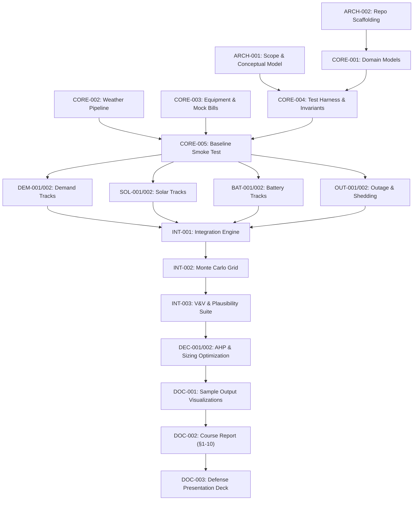

# High-Level Tasks & Roadmap — CCIS Heat, Load and Backup Power Simulation

This document defines the phased macro-architecture, milestones, exit gates, and task dependencies for CCIS Heat, Load and Backup Power Simulation. Unlike `docs/tasks/status.md` (which tracks the live state of all work units), this roadmap outlines strategic phases, critical path ordering, and delegation boundaries.

---

## Strategic Overview & Timeline

- **Scale:** 6 Phases, 23 High-Level Tasks (`PREFIX-NNN`), ~100 Low-Level Tasks (`PREFIX-NNN.n`).
- **Schedule:** 5-Day Fast-Track (Week of 2026-10-19).
- **Critical Path:**  
  `ARCH-001` → `CORE-004` → `CORE-005` → (`DEM-001/002`, `SOL-001/002`, `BAT-001/002`, `OUT-001/002` in parallel) → `INT-001` → `INT-002` → `INT-003` → `DEC-001/002` → `DOC-001` → `DOC-002/003`.

---

## Decisions to Lock ([D-05] to [D-11])

Before completing `ARCH-001.4`, the team locks the following foundational parameters extracted from deep research:

| Decision ID | Area | Recommended Choice / Value | Rationale & Evidence |
| :--- | :--- | :--- | :--- |
| **[D-05]** | **Temporal Resolution** | **Hourly (8,760 hours/year)** | Required to capture diurnal coincidence between peak afternoon heat/AC load (11:00–16:00) and peak solar generation. Daily averaging artificially flattens demand spikes. |
| **[D-06]** | **CCIS Building Archetype** | **2,500 m² floor area, 2-storey, 16 rooms (2 hyflex, 4 lecture, 1 COD, 1 Dean/Sec, 2 faculty, 6 labs; no server room)** | Confirmed MMSU CCIS ground truth. Baseline 300 kWh/day (~12.5 kW avg load, 35–45 kW hot-day peak). |
| **[D-07]** | **Cooling & Heat Response** | **CDD with $T_{\text{base}} = 24.0^\circ\text{C}$ + 4%/°C sensitivity + 20% latent penalty** | Piecewise-linear model based on tropical office empirical regressions (3–5%/°C range) and high maritime humidity penalty (10–30% range). |
| **[D-08]** | **Solar PV Parameters** | **$E = P_{\text{kWp}} \times H \times \text{PR}$ with PR = 0.77, 15° South tilt** | Validated against 103-system Luzon empirical study (mean 1,298 kWh/kWp·yr; PR 0.70–0.80). Module tempco $-0.40\%/^\circ\text{C}$, NOCT 45°C + 10°C rooftop thermal penalty. |
| **[D-09]** | **Battery Technology & Dispatch** | **LFP ($\text{LiFePO}_4$), 92% RTE, 90% usable DoD, 10% min SoC reserve** | Industry standard for safety and thermal stability in the Philippines. Self-consumption priority dispatch with configurable outage reserve. |
| **[D-10]** | **Critical Load Tiers** | **Tier 1 (2%), Tier 2 (18%), Tier 3 (80% shed on outage)** | Tier 1 (life-safety egress, alarms), Tier 2 (telecom, servers, lab computing), Tier 3 (comfort AC and non-essential lighting shed immediately to extend battery runtime 4× to 5×). |
| **[D-11]** | **Stochastic Outage Model** | **Poisson arrival + Lognormal duration** | Normal: $\lambda = 3\text{/yr}$, Lognormal($\mu=1.2, \sigma=0.8$, median 3.3h, mean 4h). Typhoon: $\lambda = 8\text{/yr}$, Lognormal($\mu=2.3, \sigma=1.0$, mean 14h, 24–48h tails) with 3–5 days solar depression (20–30% GHI). |

---

## Phase 0 — Inception, Scope Lock & Repository Foundation (Day 1)

**Purpose:** Formalize system boundary, mathematical entities, performance measures, decision variables, interface contracts, and repository tooling.

### High-Level Tasks:
- **`ARCH-001`**: Formalize Scope, Conceptual Model, State Variables, and Interface Contracts (Outline §1–3).
  - *Deliverable:* `docs/context/conceptual-model.md` containing system boundary, entities, state variables, discrete events, Mermaid flowcharts, and recorded decisions `[D-05]` through `[D-11]`.
- **`ARCH-002`**: Scaffold Repository, Toolchain, Linting, Test Runner, and Research Index (Outline §5).
  - *Deliverable:* Standard Python structure (`src/ccis_sim/`, `tests/`, `data/fixtures/`), `requirements.txt`, working `pytest` baseline, and `docs/context/research-synthesis.md`.

**Exit Gate:** All team members agree on scope and conceptual model; decisions `[D-05]`–`[D-11]` logged; `pytest` runs green on repository smoke test.

---

## Phase 1 — Core Infrastructure & Data Pipelines (Day 1–2)

**Purpose:** Establish canonical domain models, weather ingestion pipelines, synthetic demand fixtures, and invariant verification test harness.

### High-Level Tasks:
- **`CORE-001`**: Implement Canonical Domain Models & Interface Contracts (`Building`, `SolarArray`, `Battery`, `OutageEvent`, `HourlyRecord`).
- **`CORE-002`**: Implement NASA POWER Weather Ingestion & Offline CSV Fixture Cache (Batac 18.06°N, 120.56°E).
- **`CORE-003`**: Build Equipment Inventory Audit Model & Synthetic Mock Bill Generator (Outline §4).
- **`CORE-004`**: Construct Shared Test Harness & Energy Balance Invariant Checker ($\text{Residual} \le 10^{-5}\text{ kWh}$).
- **`CORE-005`**: Implement Baseline Engine Smoke Test (Zero-solar, zero-battery grid-only simulation).

**Exit Gate:** Baseline run (no solar, no battery) passes the energy-balance invariant check end-to-end for 8,760 hours without leaks.

---

## Phase 2 — Parallel Model Tracks (Day 2–3)

**Purpose:** Concurrent development of distinct sub-models in isolated worktrees (`task/<TASK-ID>`) adhering to the canonical `HourlyRecord` interface.

### High-Level Tasks:
- **`DEM-001`**: Bottom-up Equipment Load & Occupancy Schedule Model (Classrooms, labs, offices, nighttime 10% baseload).
- **`DEM-002`**: Temperature & Humidity Dependent Cooling Load Model (CDD $T_{\text{base}}=24^\circ\text{C}$, 4%/°C, latent multiplier).
- **`SOL-001`**: Solar Irradiance Geometry & NOCT Thermal Derating Model (Batac 15°S tilt, cell temperature penalty).
- **`SOL-002`**: Solar Array Sizing, Inverter Clipping & Balance-of-System Losses (PR = 0.77, soiling, wiring).
- **`BAT-001`**: Battery Dispatch Dynamics, SoC Tracking & Efficiency Losses (LFP 92% RTE, 0.5C/1.0C limits).
- **`BAT-002`**: Battery Outage Reserve Management & State-of-Charge Limits (10% min SoC, 90% DoD, self-discharge).
- **`OUT-001`**: Stochastic Outage Arrival & Duration Sampler (Poisson + Lognormal distributions, K-S test).
- **`OUT-002`**: Priority-Based Tiered Load Shedding Controller (Tiers 1, 2, and 3 automatic islanding).

**Exit Gate:** All 8 sub-models pass unit tests and independently satisfy the shared interface contract.

---

## Phase 3 — Integration, Simulation Engine & Verification (Day 3–4)

**Purpose:** Wire all components into the main CLI simulation engine, execute Monte Carlo scenario sweeps, and conduct rigorous V&V.

### High-Level Tasks:
- **`INT-001`**: Implement Integrated Time-Step Simulation Engine & CLI Application Driver (`ccis-sim`).
- **`INT-002`**: Build Monte Carlo Runner & Scenario Grid Sweeper (Weather [Normal, +2°C, 2016] × Solar [0–200 kWp] × Battery [0–200 kWh] × Outage [4, 12, 24h], P5/P50/P95, CIs).
- **`INT-003`**: Execute Comprehensive V&V Suite & Plausibility Validation (Energy conservation, ASHRAE Guideline 14 NMBE/CV(RMSE), EUI 150–300, Yield 1,200–1,600).

**Exit Gate:** Monte Carlo runs achieve statistical convergence ($z \cdot s / \sqrt{n} \le \delta$); zero energy balance violations across all runs; simulated metrics fall within published tropical ranges.

---

## Phase 4 — Decision Analysis & System Sizing Optimization (Day 4)

**Purpose:** Apply formal multi-criteria decision analysis (AHP) and optimization to determine the defensible sizing recommendation.

### High-Level Tasks:
- **`DEC-001`**: Implement Analytic Hierarchy Process (AHP) Engine (Saaty 1–9 scale, principal eigenvector, $CR \le 0.10$).
- **`DEC-002`**: Run Sizing Trade-Off Optimization & Pareto Frontier Selection (Smallest solar+battery covering 12h outage on peak heat day).

**Exit Gate:** AHP judgment matrix achieves $CR \le 0.10$; defensible sizing recommendation selected and supported by Pareto analysis.

---

## Phase 5 — Documentation, Visualizations & Defense Preparation (Day 5)

**Purpose:** Synthesize findings, produce publication-quality figures, compile the final course report (§1–10), and prepare the group defense deck.

### High-Level Tasks:
- **`DOC-001`**: Generate Publication-Quality Charts & Labelled Sample Outputs (Outline §8).
- **`DOC-002`**: Compile Course Project Final Report Document (Outline §1–10, IEEE citations).
- **`DOC-003`**: Construct Presentation Slide Deck & Group Defense Q&A Guide (Outline delivery, all 4 members present).

**Exit Gate:** Final report passes review against Project Outline sections 1–10; presentation deck ready; all group members aligned on findings.
